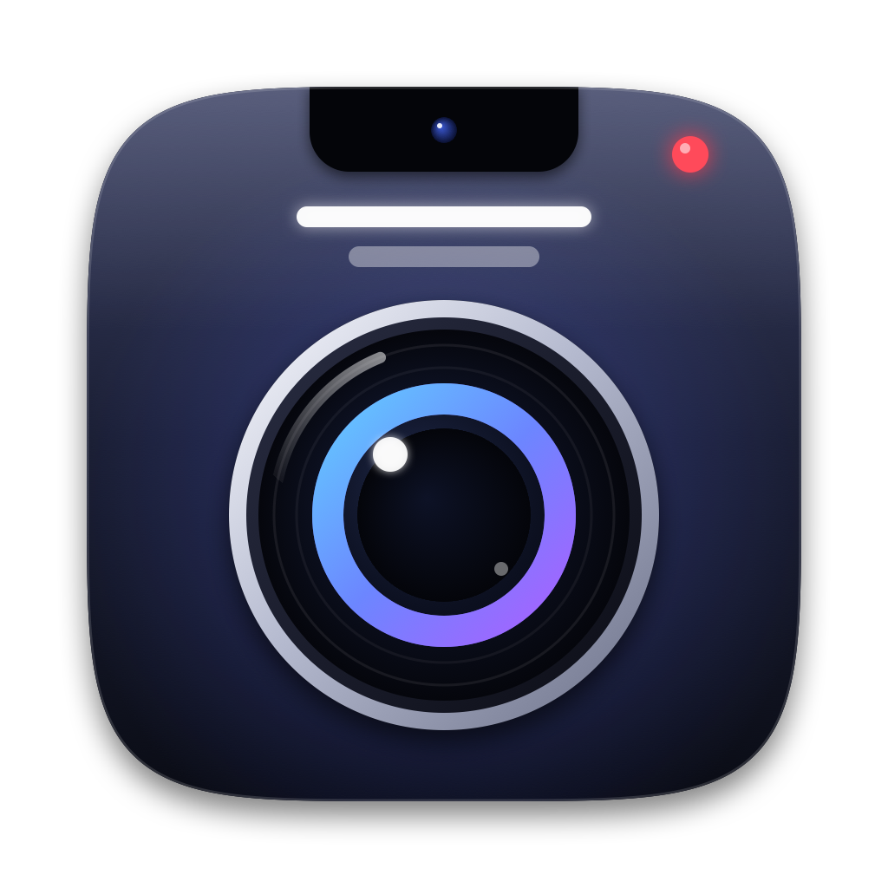

<p align="center">
  
</p>

<h1 align="center">Macam</h1>

<p align="center">
  A camera and teleprompter for the Mac, in one place.<br>
  Any aspect ratio, a teleprompter that lives in the notch and follows your voice, and a small video editor.
</p>

## Features

**Camera**
- Aspect ratios 4:3, 16:9, 16:10, 1:1 and 9:16, plus your own width × height saved as named profiles. Photos and videos are cropped to exactly what you see.
- Photos, and video in MOV or MP4 (H.264, HEVC) or ProRes 422, at 720p, 1080p, 4K or the camera's full size.
- Countdown timer, mirror, camera picker (including Continuity Camera).

**Teleprompter in the notch**
- The script sits right under the camera, so your eyes stay near the lens. Resize it by dragging its edges.
- **Speech mode** follows your voice word by word. It builds a language model from your script and matches by sound, so a misheard word doesn't lose your place.
- **Song mode** follows sung lyrics more loosely and holds still when you stop. **Scroll mode** runs at a steady pace.
- A wave beside the notch swells when you speak and settles when you're silent.
- Everything runs on your Mac. Nothing is sent anywhere.

**Video editor**
- Split, delete and restore parts, and set the speed of each part (0.25× to 4×). Trim the ends, rotate, flip, fade in and out, mute. Unlimited undo.
- Convert to MOV, MP4 (H.264 or HEVC), ProRes, audio-only M4A or an animated GIF. Edits are always saved as a new file; your original is never changed.
- Library of everything you've shot, and "Open Video to Edit…" for any video on your Mac.

## Install

Download `Macam-<version>.dmg` from the [latest release](../../releases/latest), open it and drag Macam onto Applications.

Macam is not notarized by Apple, so macOS will warn the first time. Open **System Settings → Privacy & Security**, scroll down and choose **Open Anyway**. Or, in Terminal:

```bash
xattr -dr com.apple.quarantine /Applications/Macam.app
```

Requires macOS 14 or later. The notch teleprompter needs a MacBook with a notch to sit in it; on other Macs it appears as a pill at the top of the screen.

Macam asks for camera, microphone and speech recognition access. Photos are saved to `Pictures/Macam` and videos to `Movies/Macam`.

## Build from source

You need the Xcode command line tools (full Xcode is not required).

```bash
./build.sh               # builds build/Macam.app (Apple Silicon + Intel)
./Tools/make-dmg.sh      # also packs build/Macam-<version>.dmg
./Tools/make-icon.sh     # redraws the app icon
```

Local view state uses a small `Box` helper instead of `@State`, because the command line tools SDK ships `@State` as a macro whose plugin only exists inside Xcode. If you build with Xcode you can use `@State` freely.

## Keyboard shortcuts

| | |
|---|---|
| ⌘↩ | Take a photo / start or stop recording |
| ⌘T | Show or hide the notch teleprompter |
| ⇧⌘P / ⇧⌘R | Start or pause the teleprompter / back to the start |
| ⌘E | Edit the script |
| ⌘1…⌘9 | Switch aspect ratio |
| Space, S, Delete, ⌘Z | In the editor: play, split, remove or restore a part, undo |

## Known limits

- Speech recognition is built for talking, not singing, so Song mode is much less exact than Speech mode.
- Slow motion repeats frames, so it looks choppy on footage not shot at a high frame rate.
- Parts of a video stay in their original order; you can't rearrange them.

## Contributing

Issues and pull requests are welcome.

## License

[MIT](LICENSE)
